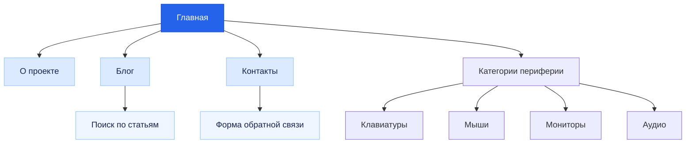
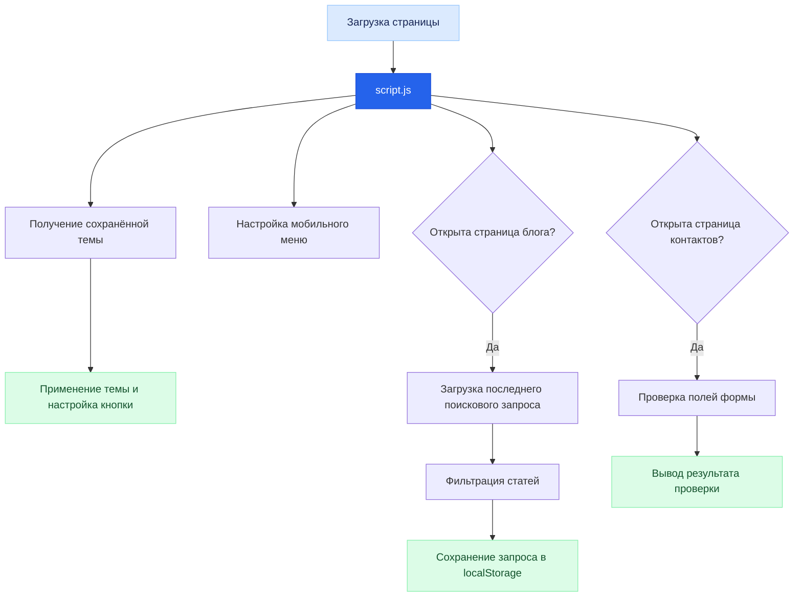

# Мир периферии — Мир компьютерной периферии

> Учебный сайт-визитка о компьютерной периферии: клавиатурах, мышах, мониторах и аудиоустройствах.

---

## 📖 О проекте

**«Мир периферии»** — учебный сайт-визитка, посвящённый компьютерной периферии и выбору устройств для работы, учёбы и игр.

Проект знакомит посетителей с основными категориями устройств, содержит информационные материалы и блог со статьями о клавиатурах, мышах, мониторах и аудио.

Сайт разработан с использованием HTML5, CSS3 и JavaScript. Для контроля версий предусмотрен Git, а для публикации сайта можно использовать GitHub Pages.

## 🎯 Цель проекта

Создать современный адаптивный многостраничный сайт, закрепить навыки семантической HTML-разметки, стилизации CSS, программирования на JavaScript, работы с Git и подготовки проектной документации.

## ✨ Функциональность

| Возможность | Описание |
|:--|:--|
| Главная страница | Знакомство с тематикой сайта, категориями периферии и последними новостями |
| О проекте | Информация о назначении сайта, его целях и используемых технологиях |
| Блог | Список статей и материалов о компьютерных устройствах |
| Поиск по блогу | Фильтрация статей по введённому запросу |
| Сохранение поиска | Последний поисковый запрос сохраняется в `localStorage` |
| Светлая и тёмная темы | Переключение оформления сайта |
| Сохранение темы | Выбранная тема сохраняется в `localStorage` и применяется при следующем посещении |
| Мобильная навигация | Раскрывающееся меню для небольших экранов |
| Контакты | Форма обратной связи с проверкой введённых данных |
| Адаптивный дизайн | Корректное отображение на компьютерах, планшетах и смартфонах |
| Активная навигация | Текущая страница выделяется в меню |

> **Примечание:** форма обратной связи работает в демонстрационном режиме: JavaScript проверяет поля и показывает сообщение об успешной отправке, но не передаёт данные на сервер или электронную почту.

## 🛠️ Используемые технологии

| Технология | Назначение |
|:--|:--|
| HTML5 | Структура и семантическая разметка страниц |
| CSS3 | Оформление, сетки, адаптивность и светлая/тёмная темы |
| JavaScript | Переключение темы, мобильное меню, поиск и проверка формы |
| `localStorage` | Сохранение выбранной темы и последнего поискового запроса |
| Git | Контроль версий проекта |
| GitHub | Хранение исходного кода |
| GitHub Pages | Возможная публикация статического сайта |
| Visual Studio Code | Редактирование и разработка проекта |

## 📁 Структура проекта

| Файл / папка | Назначение |
|:--|:--|
| `index.html` | Главная страница |
| `about.html` | Информация о проекте |
| `blog.html` | Блог и поиск по статьям |
| `contact.html` | Контакты и форма обратной связи |
| `css/style.css` | Стили сайта, темы и адаптивная вёрстка |
| `js/script.js` | JavaScript-функции и интерактивность |
| `img/logo.svg` | Логотип сайта |
| `README.md` | Документация проекта |

## 🗺️ Схема навигации сайта



## ⚙️ Схема работы JavaScript



## 💾 Использование localStorage

В проекте предусмотрено сохранение пользовательских настроек в браузере.

| Ключ | Что хранит | Где используется |
|:--|:--|:--|
| `theme` | Выбранная тема: `light` или `dark` | На всех страницах |
| `lastSearch` | Последний поисковый запрос | На странице блога |
| `lastName` | Имя, введённое в успешно проверенной форме | На странице контактов |

Данные сохраняются в браузере пользователя и не отправляются на сервер.

## 🚀 Запуск проекта

### 1. Получение проекта

Если проект уже находится на компьютере, открой его папку в Visual Studio Code.

Если проект размещён в GitHub-репозитории, склонируй его:

```bash
git clone https://github.com/USERNAME/REPOSITORY.git
cd REPOSITORY
```

Замени `USERNAME` и `REPOSITORY` на имя пользователя и название своего репозитория.

### 2. Открытие в Visual Studio Code

```bash
code .
```

### 3. Запуск сайта

Открой файл `index.html` в браузере.

Для удобной локальной разработки можно установить расширение **Live Server** в Visual Studio Code, нажать правой кнопкой мыши на `index.html` и выбрать **Open with Live Server**.

Проект является статическим сайтом и не требует установки дополнительных зависимостей.

## 🌐 Публикация на GitHub Pages

Чтобы опубликовать сайт:

1. Создай репозиторий на GitHub.
2. Загрузи в него файлы проекта, сохранив структуру папок.
3. Открой `Settings → Pages`.
4. В разделе публикации выбери ветку `main` и папку `/ (root)`.
5. Нажми **Save** и дождись завершения публикации.

После публикации GitHub Pages покажет адрес сайта. Обычно он имеет вид:

`https://USERNAME.github.io/REPOSITORY/`

## 🌿 Git workflow

Для разработки новых функций можно использовать отдельную ветку `test`, оставляя `main` для стабильной версии сайта.

### Создание тестовой ветки

```bash
git checkout -b test
```

### Сохранение изменений

```bash
git add .
git commit -m "feat: add new website feature"
git push -u origin test
```

### Объединение изменений с основной веткой

После проверки изменений:

```bash
git checkout main
git merge test
git push origin main
```

Ветка `main` предназначена для стабильной версии проекта, а `test` — для экспериментов и разработки новых функций.

## 📌 Результаты работы

В рамках проекта создан многостраничный адаптивный сайт о компьютерной периферии. Реализованы навигация между страницами, переключение светлой и тёмной тем, мобильное меню, поиск по блогу с сохранением запроса и клиентская проверка формы обратной связи.

Проект демонстрирует применение HTML5, CSS3, JavaScript, `localStorage` и Git в разработке статического веб-сайта.

## 📄 Лицензия

Лицензия проекта отдельно не указана. Условия использования исходного кода, дизайна и материалов могут быть определены автором отдельно.

---

<p align="center">
  <em>Мир периферии — выбирай устройства с умом.</em>
</p>
